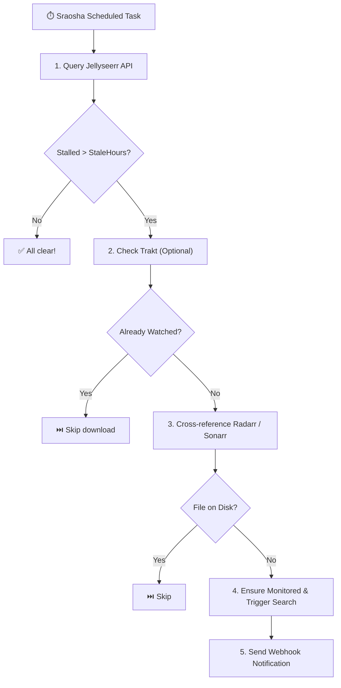

# 🛡️ Sraosha (سروش)

### *The Sleepless Sentinel for Jellyfin*

[](https://github.com/ghahramani/jellyfin-plugin-sraosha/releases)
[](https://github.com/ghahramani/jellyfin-plugin-sraosha/actions)
[](https://jellyfin.org/)
[](LICENSE)

<p align="center">
  
</p>

---

## 📖 The Myth behind the Name

In ancient Persian/Zoroastrian tradition, **Sraosha (سروش)** is the divine herald and sleepless guardian of the realm. Sraosha **never sleeps**—three times each night, he patrols the earth with his celestial staff raised, protecting creation against chaos, negligence, and darkness while everyone else rests.

In your media stack, Sraosha plays the exact same role: whenever a requested download stalls at 0%, gets accidentally deleted from your torrent client, or slips through the cracks between **Jellyseerr**, **Radarr**, and **Sonarr**, Sraosha awakens the pipeline and restores what was lost.

---

## ⚡ Features

- 🔍 **Automated Jellyseerr Watchdog**: Continuously tracks requests remaining in `Processing` state beyond your chosen time threshold (default: 2 hours).
- 🎬 **Radarr Movie Reviver**:
  - Checks if requested movies actually have files on disk in Radarr.
  - Ensures the movie is set to `Monitored`.
  - Automatically triggers `MoviesSearch` to re-grab the release.
- 📺 **Sonarr Episode Patrol**:
  - Validates series status and inspects specifically requested seasons.
  - Detects aired episodes with missing files on disk.
  - Ensures monitoring and sends batched `EpisodeSearch` commands.
- 👁️ **Trakt Watch History Sync (Optional)**:
  - Prevents re-downloading media you've already watched and intentionally purged from your disk.
- 🔀 **Multi-Instance Architecture**:
  - Configure multiple Radarr and Sonarr instances (e.g. standard 1080p, 4K HDR, or Anime).
- 🧪 **Dry-Run Mode & Live Health Checks**:
  - Test API connections for all services directly within the Jellyfin Dashboard.
  - Run in Dry-Run mode to verify exactly what Sraosha would search before modifying your library.
- 🔔 **Instant Webhook Notifications**:
  - Sends clean alert summaries to **Discord**, **ntfy**, or **Slack** whenever missing media is revived.
- ⏱️ **Native Scheduled Task**:
  - Integrates seamlessly with Jellyfin's `IScheduledTask` system (Dashboard → Scheduled Tasks). Customize triggers or click **Start** on-demand.

---

## 🔄 How It Works



---

## 🚀 Installation

### Option 1: Plugin Repository (Recommended)

1. Open your **Jellyfin Dashboard**.
2. Navigate to **Plugins** → **Repositories**.
3. Click the **+** (Add) button and enter:
   - **Repository Name:** `Sraosha Repository`
   - **Repository URL:**
     ```text
     https://raw.githubusercontent.com/ghahramani/jellyfin-plugin-sraosha/main/manifest.json
     ```
4. Save, then switch to the **Catalog** tab.
5. Find **Sraosha** under the *General* category and click **Install**.
6. Restart your Jellyfin server.

---

### Option 2: Manual Installation

1. Download the latest `Jellyfin.Plugin.Sraosha_1.0.0.0.zip` from [Releases](https://github.com/ghahramani/jellyfin-plugin-sraosha/releases).
2. Extract the archive into your Jellyfin `plugins` directory under a folder named `Sraosha_1.0.0.0`:
   ```bash
   # Example path on Linux / Docker
   mkdir -p /config/plugins/Sraosha_1.0.0.0
   unzip Jellyfin.Plugin.Sraosha_1.0.0.0.zip -d /config/plugins/Sraosha_1.0.0.0/
   ```
3. Restart Jellyfin.

---

## ⚙️ Configuration

Once installed, navigate to **Dashboard** → **Plugins** → **Sraosha**:

| Setting | Default | Description |
|---|---|---|
| **Jellyseerr URL** | `http://localhost:5055` | The base URL of your Jellyseerr/Overseerr instance. |
| **Jellyseerr API Key** | `—` | API key from Jellyseerr Settings → General → API Key. |
| **Stale Threshold** | `2 hours` | Requests older than this in `processing` state are inspected. |
| **Dry-Run Mode** | `Disabled` | When enabled, logs actions without firing search commands. |
| **Radarr Instances** | `1 instance` | Add multiple Radarr servers (URL, API Key, Enabled toggle). |
| **Sonarr Instances** | `1 instance` | Add multiple Sonarr servers (URL, API Key, Enabled toggle). |
| **Trakt Integration** | `Disabled` | Skips re-downloading media already marked as watched in Trakt. |
| **Webhook URL** | `—` | Discord / ntfy webhook URL for scan alerts. |

---

## 🛠️ Building from Source

Requirements:
- [.NET 8.0 SDK](https://dotnet.microsoft.com/download) or Docker

```bash
git clone https://github.com/ghahramani/jellyfin-plugin-sraosha.git
cd jellyfin-plugin-sraosha

# Build release and package zip
./build.sh

# Or build and install directly to local Jellyfin container
./build.sh --install
```

The resulting zip package and MD5 hash will be generated under `./dist/`.

---

## 📄 License

This project is licensed under the [MIT License](LICENSE).
